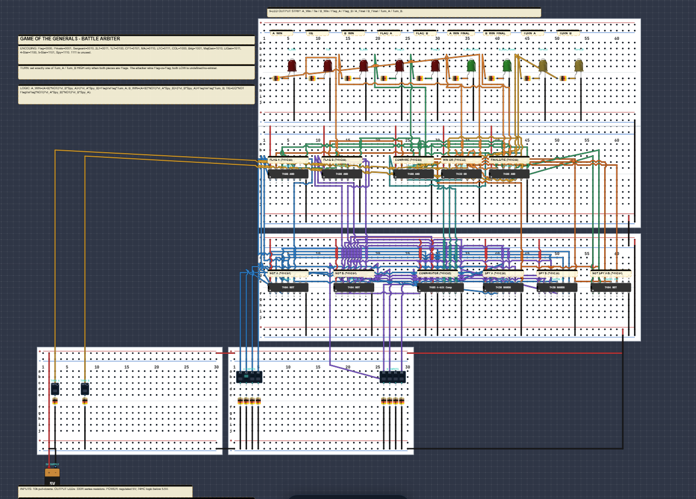
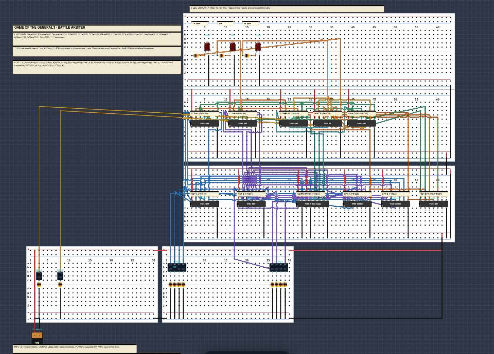

# Game of the Generals — Battle Arbiter

This project is a **digital battle arbiter** for the game *Game of the Generals*. It reads two 4-bit piece codes (`A` and `B`), compares their ranks, applies the special Flag / Spy / Private rules, resolves Flag-vs-Flag with a Turn switch, and lights the result LEDs.

There are two finished versions:

| File | Display | Use |
|---|---|---|
| **`Arbiter-9.json`** | 9 LEDs | Full teaching/debug version: round result, flags, final capture, and turn indicators |
| **`Arbiter-9-3LED.json`** | 3 LEDs | Compact version: only `A_Win`, `Tie`, `B_Win` are displayed; the rest is still computed internally |

The `-routed` files (`Arbiter-9-routed.json`, `Arbiter-9-3LED-routed.json`) are byte-identical backups of the two final files. Use either copy.

### Preview

**9-LED version**



**3-LED version**



---

## 1. Quick start in LogicBench

1. Open **https://www.logicbench.online/simulator-app**
2. Load **`Arbiter-9.json`** (or **`Arbiter-9-3LED.json`**) with the app's Open/Import button.
3. Wait for the simulator to finish loading.
4. Use **Fit to view** so the whole breadboard layout is visible.
5. Set the **A** and **B** DIP switches to the two piece codes.
6. Leave **Turn_A** and **Turn_B** OFF for normal rounds.
7. For **Flag vs Flag only**, turn exactly one of **Turn_A** / **Turn_B** ON.
8. Read the LEDs.

The battery symbol is already set to **5.0 V**. Do not change it to 9 V.

---

## 2. What the circuit decides

The arbiter answers three questions:

1. **Who wins this round?** → `A_Win`, `Tie`, or `B_Win`
2. **Is either piece a Flag?** → `Flag_A`, `Flag_B`
3. **Did someone capture the enemy Flag and win the game?** → `A_Win_Final`, `B_Win_Final`

> **Important distinction**
>
> - `A_Win` means **A won the round**.
> - `A_Win_Final` means **A won the game by defeating B's Flag**.
> - `A_Win_Final = A_Win AND Flag_B`.
> - So A can light `A_Win` without lighting `A_Win_Final` when B is not a Flag.

---

## 3. Piece encoding

The 4-bit code is written as `A3 A2 A1 A0` (A3 is the most significant bit).

| Code | Piece | Code | Piece |
|---|---|---|---|
| `0000` | **Flag** | `1000` | Colonel |
| `0001` | **Private** | `1001` | Brigadier General |
| `0010` | Sergeant | `1010` | Major General |
| `0011` | 2nd Lieutenant | `1011` | Lieutenant General |
| `0100` | 1st Lieutenant | `1100` | 4-Star General |
| `0101` | Captain | `1101` | 5-Star General |
| `0110` | Major | `1110` | **Spy** |
| `0111` | Lieutenant Colonel | `1111` | **Unused — do not use** |

### Normal rank order

`Flag < Private < Sergeant < 2LT < 1LT < CPT < MAJ < LTC < COL < Brigadier < Maj Gen < Lt Gen < 4-Star < 5-Star < Spy`

But there are two special rules:

- **Private beats Spy.** A Private is the only piece that can defeat a Spy.
- **Flag is special.** A Flag loses to every non-Flag piece. Flag vs Flag is decided by the Turn switches, not by rank.

`Spy` is code `1110`, **not** `1111`. Code `1111` is unused.

---

## 4. Inputs

| Input | Where | Meaning |
|---|---|---|
| `A3 A2 A1 A0` | A DIP switch `c2`, switches S1–S4 | A's piece code. S1 = A3 (MSB), S4 = A0 (LSB) |
| `B3 B2 B1 B0` | B DIP switch `c3`, switches S1–S4 | B's piece code. S1 = B3 (MSB), S4 = B0 (LSB) |
| `Turn_A` | Turn A DIP `c4201` | A is the attacker in a Flag-vs-Flag battle |
| `Turn_B` | Turn B DIP `c4202` | B is the attacker in a Flag-vs-Flag battle |

Each switch input has its own **10 kΩ pull-down** to GND. The DIP-switch common side goes to **+5 V**. Therefore:

- Switch **ON** → input is **HIGH** (`1`)
- Switch **OFF** → input is **LOW** (`0`)

### Switch example

`1LT = 0100` means:

- A3 = 0 → OFF
- A2 = 1 → ON
- A1 = 0 → OFF
- A0 = 0 → OFF

Label the physical switches **A3 A2 A1 A0** and **B3 B2 B1 B0** with tape so the MSB is not confused with the LSB.

### Turn switch rule

- Normal round: **both Turn switches OFF**.
- Flag vs Flag: set **exactly one** Turn switch ON.
- Both OFF → no winner / undefined for Flag vs Flag.
- Both ON → invalid; both final-win LEDs can light.

---

## 5. Outputs

### 9-LED version

| LED | Ref | Color | Meaning |
|---|---|---|---|
| `A_Win` | `c1871` | Red | A wins the round |
| `Tie` | `c1872` | Red | Equal non-Flag ranks, with no Private/Spy upset |
| `B_Win` | `c1873` | Red | B wins the round |
| `Flag_A` | `c4001` | Red | A's piece is Flag (`0000`) |
| `Flag_B` | `c4002` | Red | B's piece is Flag (`0000`) |
| `A_Win_Final` | `c4003` | Green | A wins the game by defeating B's Flag |
| `B_Win_Final` | `c4004` | Green | B wins the game by defeating A's Flag |
| `Turn_A` | `c4005` | Yellow | Turn_A switch is ON |
| `Turn_B` | `c4006` | Yellow | Turn_B switch is ON |

The Turn LEDs are simple switch indicators. They are **not** gated by Flag-vs-Flag, so they will light in a normal round if you leave a Turn switch ON. The result logic ignores the Turn signals unless both pieces are Flags.

### 3-LED version

Only these are shown:

| LED | Ref | Meaning |
|---|---|---|
| `A_Win` | `c1871` | A wins the round |
| `Tie` | `c1872` | Tie |
| `B_Win` | `c1873` | B wins the round |

The Flag, Final, and Turn signals still exist internally. You can probe them at the IC pins listed in the 3-LED table below.

| Internal signal | Probe point |
|---|---|
| `Flag_A` | `c501` pin 8 |
| `Flag_B` | `c502` pin 8 |
| `A_Win_Final` | `c1319` pin 11 |
| `B_Win_Final` | `c1319` pin 3 |
| `Turn_A` | `c4201` pin S1 |
| `Turn_B` | `c4202` pin S1 |

If you want the final game result visible in the 3-LED build, add two optional green LEDs (with 330 Ω resistors) driven by `c1319` pin 11 (`A_Win_Final`) and `c1319` pin 3 (`B_Win_Final`), or use a logic probe on those pins.

---

## 6. How the arbiter decides — plain English

Think of the logic as checking these cases in this priority order (the hardware is combinational, so it all evaluates at once):

### Case 1 — Private kills Spy

- A is **Private** (`0001`) and B is **Spy** (`1110`) → **A wins**.
- B is **Private** (`0001`) and A is **Spy** (`1110`) → **B wins**.

This overrides the normal rank comparison.

### Case 2 — Flag vs Flag

If both pieces are Flags (`0000` and `0000`):

- `Turn_A` ON → **A wins**
- `Turn_B` ON → **B wins**
- Neither ON → no result (invalid)
- Both ON → invalid

This is not a Tie. The attacker wins.

### Case 3 — Normal rank comparison

If neither special case applies:

- `A > B` → **A wins**
- `A < B` → **B wins**
- `A = B` → **Tie**

The comparator is a 74HC85.

### Case 4 — Final game win

After the round winner is known:

- If **A wins** and **B is Flag** → `A_Win_Final`
- If **B wins** and **A is Flag** → `B_Win_Final`

So a Flag can never win a normal round; it can only be captured. The only Flag "win" is the Flag-vs-Flag turn decision.

---

## 7. Boolean equations

Notation:

- `·` = AND
- `+` = OR
- `'` = NOT
- `A_GT_B` = comparator output "A greater than B"
- `A_EQ_B` = comparator output "A equal to B"
- `A_LT_B` = comparator output "A less than B"

Define:

```text
Flag_A = (A3 + A2 + A1 + A0)'
Flag_B = (B3 + B2 + B1 + B0)'
FlagVsFlag = Flag_A · Flag_B

PvtKillsSpy_A = (A = 0001) · (B = 1110)     // A's Private kills B's Spy
PvtKillsSpy_B = (B = 0001) · (A = 1110)     // B's Private kills A's Spy
```

Then:

```text
A_Win = (A_GT_B · PvtKillsSpy_B') + PvtKillsSpy_A + (FlagVsFlag · Turn_A)

B_Win = (A_LT_B · PvtKillsSpy_A') + PvtKillsSpy_B + (FlagVsFlag · Turn_B)

Tie   = A_EQ_B · FlagVsFlag' · PvtKillsSpy_A' · PvtKillsSpy_B'

A_Win_Final = A_Win · Flag_B
B_Win_Final = B_Win · Flag_A
```

### Why the `PvtKillsSpy'` terms are there

The normal comparator terms are inhibited when the opponent's Private is killing your Spy:

- A's normal `A_GT_B` win is blocked if `PvtKillsSpy_B` is true.
- B's normal `A_LT_B` win is blocked if `PvtKillsSpy_A` is true.

The special upset wins are then added separately with `+ PvtKillsSpy_A` and `+ PvtKillsSpy_B`.

---

## 8. Signal dictionary

| Signal | Active level | Where it comes from | Meaning |
|---|---|---|---|
| `A3..A0` | High = 1 | A DIP switch | A's code |
| `B3..B0` | High = 1 | B DIP switch | B's code |
| `/A3../A0` | High = inverted | `c56` 74HC04 | Inverted A bits |
| `/B3../B0` | High = inverted | `c57` 74HC04 | Inverted B bits |
| `A_GT_B` | High | `c118` pin 5 | A > B |
| `A_EQ_B` | High | `c118` pin 6 | A = B |
| `A_LT_B` | High | `c118` pin 7 | A < B |
| `PKS_A_N` | **Low** = true | `c351` pin 8 | A's Private kills B's Spy |
| `PKS_B_N` | **Low** = true | `c352` pin 8 | B's Private kills A's Spy |
| `PKS_A` | High = true | `c445` pin 12 | Inverted `PKS_A_N` |
| `PKS_B` | High = true | `c445` pin 10 | Inverted `PKS_B_N` |
| `FVF` | High | `c1205` pin 8 | Both pieces are Flags |
| `/FVF` | Low = true | `c445` pin 2 | Inverted `FVF` |
| `TieBase` | High | `c1319` pin 8 | Equal ranks and not Flag vs Flag |
| `TieA` | High | `c501` pin 11 | `TieBase` and no A-Private/B-Spy upset |
| `Tie` | High | `c502` pin 11 | Final Tie signal |
| `A_Win` | High | `c1206` pin 8 | A wins the round |
| `B_Win` | High | `c1206` pin 11 | B wins the round |
| `A_Win_Final` | High | `c1319` pin 11 | A wins the game |
| `B_Win_Final` | High | `c1319` pin 3 | B wins the game |

The `_N` suffix means **active-low**: the signal is true when it is LOW. The 74HC30 NAND gates naturally produce active-low outputs.

---

## 9. Board map — which board does what

The drawing uses five breadboards. The app indices are:

| Board | Size | Location | Contents |
|---|---|---|---|
| **Board 0** | Half (30 cols) | Center-bottom | A and B DIP switches, 8× 10 kΩ pull-downs |
| **Board 1** | Full (63 cols) | Above board 0 | Input inverters, comparator, Spy/Private detectors, Flag-vs-Flag inverter |
| **Board 2** | Full (63 cols) | Above board 1 | Flag detectors, comparison terms, win OR gates, final/Tie gates |
| **Board 3** | Half (30 cols) | Left of board 0 | Turn A/B switches, 2× 10 kΩ pull-downs, 5 V supply |
| **Board 4** | Full (63 cols) | Top | 9 output LEDs and 9× 330 Ω resistors |

Signal flow:

```text
Board 3: Turn switches + 5 V
             │
Board 0: A/B switches + pull-downs
             │
Board 1: NOT A/B → comparator → Spy detectors → inverters
             │
Board 2: Flag detectors → compare terms → OR → final/Tie
             │
Board 4: output LEDs
```

### How to read the drawing labels

- **Above each IC:** a function label, such as `COMPARATOR (74HC85)` or `WIN OR (74HC32)`.
- **On each IC:** the package label, such as `74HC08 C` or `74HC30 A`.
- **Above each LED:** the signal name, such as `A_WIN` or `B_WIN_FINAL`.
- **Top notes:** encoding, Turn rule, Boolean equations, and real-build guidance.
- **Wire colors:** see the color table in section 17.

---

## 10. Gate-by-gate — what each IC does

### Board 1 — top logic row

| Ref | Package | Label | Pin connections | Function |
|---|---|---|---|---|
| `c56` | 74HC04 | `NOT A` | `1=A3→2=/A3`, `3=A2→4=/A2`, `11=A0→10=/A0`, `13=A1→12=/A1` | Inverts A bits for the Flag and Spy detectors |
| `c57` | 74HC04 | `NOT B` | `1=B3→2=/B3`, `3=B2→4=/B2`, `11=B0→10=/B0`, `13=B1→12=/B1` | Inverts B bits |
| `c118` | 74HC85 | `COMPARATOR` | `A3=15, A2=13, A1=12, A0=10`; `B3=1, B2=14, B1=11, B0=9`; `IA<B=2=GND`, `IA=B=3=+5V`, `IA>B=4=GND`; outputs `5=A>B`, `6=A=B`, `7=A<B` | Compares the two 4-bit ranks |
| `c351` | 74HC30 | `SPY A` | Inputs `1=/A3, 2=/A2, 3=/A1, 4=A0, 5=B3, 6=B2, 11=/B0, 12=B1`; output `8=PKS_A_N` | 8-input NAND. Goes LOW only when A=`0001` and B=`1110` (A Private vs B Spy) |
| `c352` | 74HC30 | `SPY B` | Inputs `1=/B3, 2=/B2, 3=/B1, 4=B0, 5=A3, 6=A2, 11=/A0, 12=A1`; output `8=PKS_B_N` | 8-input NAND. Goes LOW only when B=`0001` and A=`1110` (B Private vs A Spy) |
| `c445` | 74HC04 | `NOT SPY A/B` | `1=FVF→2=/FVF`; `11=PKS_B_N→10=PKS_B`; `13=PKS_A_N→12=PKS_A` | Inverts the Flag-vs-Flag and Spy-detector signals. Gates 2, 3, and 4 are unused |

**Label warning:** `SPY A` means **"A's Private kills B's Spy"** (`Pvt_A · Spy_B`). It does **not** mean "A is the Spy." The original label came from the earlier Arbiter-5 design. The same applies to `SPY B`. Also, the `NOT SPY A/B` label is short: that 74HC04 package also contains the inverter for `FlagVsFlag`, not just the two Spy signals. See the `c445` row above.

### Board 2 — bottom logic row

| Ref | Package | Label | Pin connections | Function |
|---|---|---|---|---|
| `c501` | 74HC08 | `FLAG A` | Gate 1: `1=/A3, 2=/A2 → 3`; Gate 2: `4=/A1, 5=/A0 → 6`; Gate 3: `9=gate2, 10=gate1 → 8=Flag_A`; Gate 4: `12=TieBase, 13=PKS_A_N → 11=TieA` | 4-input AND that detects A=`0000`; also builds the first Tie stage |
| `c502` | 74HC08 | `FLAG B` | Gate 1: `1=/B3, 2=/B2 → 3`; Gate 2: `4=/B1, 5=/B0 → 6`; Gate 3: `9=gate2, 10=gate1 → 8=Flag_B`; Gate 4: `12=TieA, 13=PKS_B_N → 11=Tie` | 4-input AND that detects B=`0000`; also builds the final Tie signal |
| `c1205` | 74HC08 | `COMPARE` | Gate 1: `1=A_GT_B, 2=PKS_B_N → 3=A_GT_TERM`; Gate 2: `4=A_LT_B, 5=PKS_A_N → 6=B_LT_TERM`; Gate 3: `9=Flag_A, 10=Flag_B → 8=FVF`; Gate 4: `12=FVF, 13=Turn_A → 11=A_FVF_TERM` | Builds the normal compare terms, Flag-vs-Flag, and A's Flag-vs-Flag term |
| `c1206` | 74HC32 | `WIN OR` | Gate 1: `1=A_GT_TERM, 2=PKS_A → 3=A_PARTIAL`; Gate 2: `4=B_LT_TERM, 5=PKS_B → 6=B_PARTIAL`; Gate 3: `9=A_PARTIAL, 10=A_FVF_TERM → 8=A_Win`; Gate 4: `12=B_PARTIAL, 13=B_FVF_TERM → 11=B_Win` | ORs the normal win, Spy-upset win, and Flag-vs-Flag win |
| `c1319` | 74HC08 | `FINALS/TIE` | Gate 1: `1=B_Win, 2=Flag_A → 3=B_Win_Final`; Gate 2: `4=FVF, 5=Turn_B → 6=B_FVF_TERM`; Gate 3: `9=A_EQ_B, 10=/FVF → 8=TieBase`; Gate 4: `12=Flag_B, 13=A_Win → 11=A_Win_Final` | Builds the two final-win signals, B's Flag-vs-Flag term, and the Tie base |

### Board 3 — Turn and supply

| Ref | Part | Function |
|---|---|---|
| `c4201` | 1-position DIP | `Turn_A` switch |
| `c4202` | 1-position DIP | `Turn_B` switch |
| `c4301` | 10 kΩ | Pull-down for `Turn_A` |
| `c4302` | 10 kΩ | Pull-down for `Turn_B` |
| `c2132` | 5 V source | Regulated 5 V supply symbol (the app's 9 V battery shape is set to 5 V) |

### Board 4 — outputs

| LED | Ref | Color | Series resistor | Driven by |
|---|---|---|---|---|
| `A_Win` | `c1871` | Red | `c3001` 330 Ω | `c1206` pin 8 |
| `Tie` | `c1872` | Red | `c3002` 330 Ω | `c502` pin 11 |
| `B_Win` | `c1873` | Red | `c3003` 330 Ω | `c1206` pin 11 |
| `Flag_A` | `c4001` | Red | `c4101` 330 Ω | `c501` pin 8 |
| `Flag_B` | `c4002` | Red | `c4102` 330 Ω | `c502` pin 8 |
| `A_Win_Final` | `c4003` | Green | `c4103` 330 Ω | `c1319` pin 11 |
| `B_Win_Final` | `c4004` | Green | `c4104` 330 Ω | `c1319` pin 3 |
| `Turn_A` | `c4005` | Yellow | `c4105` 330 Ω | `Turn_A` switch node |
| `Turn_B` | `c4006` | Yellow | `c4106` 330 Ω | `Turn_B` switch node |

LED wiring: **logic output → 330 Ω → LED anode → LED cathode → GND**. The LED lights when the logic output is HIGH.

---

## 11. Input pull-down map

Each signal has its own 10 kΩ resistor to GND. The switch connects the signal to +5 V when ON.

| Signal | DIP switch pin | Pull-down |
|---|---|---|
| `A3` | `c2` S1 | `c4` |
| `A2` | `c2` S2 | `c5` |
| `A1` | `c2` S3 | `c6` |
| `A0` | `c2` S4 | `c7` |
| `B3` | `c3` S1 | `c9` |
| `B2` | `c3` S2 | `c10` |
| `B1` | `c3` S3 | `c11` |
| `B0` | `c3` S4 | `c8` |
| `Turn_A` | `c4201` S1 | `c4301` |
| `Turn_B` | `c4202` S1 | `c4302` |

Note that `B0` uses `c8`, not `c11`; the physical layout order is not the same as the signal order.

---

## 12. Example cases

`Turn` column: `00` = both off, `10` = Turn_A on, `01` = Turn_B on.

| A | B | Turn | A_Win | Tie | B_Win | Flag_A | Flag_B | A_Final | B_Final | Why |
|---|---|---|---|---|---|---|---|---|---|---|
| `0110` MAJ | `0101` CPT | 00 | 1 | 0 | 0 | 0 | 0 | 0 | 0 | Normal A > B |
| `0101` CPT | `0101` CPT | 00 | 0 | 1 | 0 | 0 | 0 | 0 | 0 | Equal non-Flag ranks |
| `0001` Pvt | `1110` Spy | 00 | 1 | 0 | 0 | 0 | 0 | 0 | 0 | Private kills Spy |
| `1110` Spy | `0001` Pvt | 00 | 0 | 0 | 1 | 0 | 0 | 0 | 0 | Private kills Spy |
| `0000` Flag | `0001` Pvt | 00 | 0 | 0 | 1 | 1 | 0 | 0 | 1 | B captures A's Flag |
| `0001` Pvt | `0000` Flag | 00 | 1 | 0 | 0 | 0 | 1 | 1 | 0 | A captures B's Flag |
| `0000` Flag | `0000` Flag | 10 | 1 | 0 | 0 | 1 | 1 | 1 | 0 | Turn_A decides |
| `0000` Flag | `0000` Flag | 01 | 0 | 0 | 1 | 1 | 1 | 0 | 1 | Turn_B decides |
| `0000` Flag | `0000` Flag | 00 | 0 | 0 | 0 | 1 | 1 | 0 | 0 | Invalid: no attacker |
| `1110` Spy | `1110` Spy | 00 | 0 | 1 | 0 | 0 | 0 | 0 | 0 | Spy vs Spy ties |
| `0000` Flag | `1110` Spy | 00 | 0 | 0 | 1 | 1 | 0 | 0 | 1 | Spy captures Flag |
| `1110` Spy | `0000` Flag | 00 | 1 | 0 | 0 | 0 | 1 | 1 | 0 | Spy captures Flag |

For the 3-LED version, read only the `A_Win`, `Tie`, and `B_Win` columns.

These are examples only. **Section 21 lists the complete truth table for every valid piece pair and Turn combination (the unused `1111` code is excluded).**

---

## 13. Real-build guide

### 13.1 Bill of materials

| Qty | Part | Notes |
|---|---|---|
| 2 | **74HC04** hex inverter | Optimized build. Use 3 if you want to follow the drawing literally, one package per inverter symbol |
| 4 | **74HC08** quad AND | `c501`, `c502`, `c1205`, `c1319`; all 4 gates in each package are used |
| 1 | **74HC32** quad OR | `c1206`; all 4 gates used |
| 2 | **74HC30** 8-input NAND | `c351`, `c352` |
| 1 | **74HC85** 4-bit comparator | `c118` |
| 2 | 4-position DIP switch | A and B inputs |
| 2 | 1-position DIP switch or SPST switch | Turn_A and Turn_B |
| 10 | 10 kΩ resistor | 8 input pull-downs + 2 turn pull-downs |
| 9 | 330 Ω resistor | 9-LED version |
| 3 | 330 Ω resistor | 3-LED version |
| 5 | Red LED | `A_Win`, `Tie`, `B_Win`, `Flag_A`, `Flag_B` (9-LED) |
| 2 | Green LED | `A_Win_Final`, `B_Win_Final` (9-LED) |
| 2 | Yellow LED | `Turn_A`, `Turn_B` (9-LED) |
| 3 | Red LED | 3-LED version only |
| 10–11 | 100 nF ceramic capacitor | One per IC package, from +5 V to GND |
| 1 | Regulated 5 V supply | 5 V adapter or 7805; **not** a bare 9 V battery |
| 5 | Breadboards | 3 full-size + 2 half-size, or 5 full-size |
| — | Solid-core wire, IC sockets, labels | Recommended |

The LED and 330 Ω rows are alternatives: build either the 9-LED set **or** the 3-LED set, not both on the same board.

### 13.2 74HC pinouts

**74HC04 hex inverter**

```text
1A=1  1Y=2    2A=3  2Y=4    3A=5  3Y=6    GND=7
4Y=8  4A=9    5Y=10 5A=11   6Y=12 6A=13   VCC=14
```

**74HC08 quad AND / 74HC32 quad OR** (same pinout)

```text
1A=1  1B=2  1Y=3    2A=4  2B=5  2Y=6    GND=7
3Y=8  3A=9  3B=10   4Y=11 4A=12 4B=13   VCC=14
```

**74HC30 8-input NAND**

```text
Inputs: 1, 2, 3, 4, 5, 6, 11, 12
Output: 8
GND: 7
VCC: 14
NC: 9, 10, 13
```

**74HC85 4-bit comparator**

```text
B3=1    IA<B=2   IA=B=3   IA>B=4   OA>B=5   OA=B=6   OA<B=7   GND=8
B0=9    A0=10    B1=11    A1=12    A2=13    B2=14    A3=15    VCC=16
```

For a single-stage comparison:

- `IA<B` (pin 2) = GND
- `IA=B` (pin 3) = **+5 V**
- `IA>B` (pin 4) = GND

This is important. If pin 3 is not tied HIGH, the comparator outputs can be wrong.

### 13.3 Package mapping for the 74HC04s

The drawing uses **three separate 74HC04 package symbols**. In a real build you can use either:

**Option A — build exactly as drawn (3× 74HC04)**

- `c56` = one 74HC04
- `c57` = one 74HC04
- `c445` = one 74HC04

This works and is the easiest to follow, but it wastes several inverter gates.

**Option B — optimized (2× 74HC04)**

| Package | Gates used |
|---|---|
| 74HC04 #1 | `c56` A3, A2, A1, A0 inverters + `c445` Flag-vs-Flag inverter + `c445` `PKS_B` inverter |
| 74HC04 #2 | `c57` B3, B2, B1, B0 inverters + `c445` `PKS_A` inverter (one spare gate) |

The logic is identical; only the physical package grouping changes. With Option B, connect VCC/GND to both 74HC04 packages; the third inverter symbol in the drawing is not a separate package.

### 13.4 Wiring and power rules

1. **DIP-switch common → +5 V.** Each switch signal goes to its 10 kΩ pull-down and to the logic input. The app's DIP-switch symbol omits the common pin; in the real build, the common side of each switch goes to +5 V.
2. **Turn switches** use the same arrangement: common → +5 V, signal → 10 kΩ → GND.
3. **IC orientation:** follow the notch/dot. With the notch at the top, pin 1 is the top-left pin.
4. **74HC VCC/GND:** pin 14/7 for 14-pin parts; pin 16/8 for the 74HC85.
5. **100 nF decoupling capacitor** from +5 V to GND at every IC package, as close as possible.
6. **Unused 74HC inputs must not float.** Tie them to GND or +5 V. Unused outputs can be left open.
7. **74HC30 pins 9, 10, 13 are NC.** Do not connect them.
8. **LEDs:** logic output → 330 Ω → LED anode; LED cathode → GND.
9. **Rails:** check whether your breadboard's power rails are split in the middle. If they are, add short red/black jumpers to make each rail continuous across the board.
10. **Supply:** use a regulated 5.0 V supply rated for at least 500 mA. The 74HC family is specified up to 5.5 V; do not run it from a raw 9 V battery.
11. **Current:** 330 Ω at 5 V gives roughly 9 mA per LED. With all 9 LEDs on, that is about 80 mA total, so a 500 mA supply is comfortable. The 74HC datasheet's recommended output current is lower (about 4 mA), so if you want to be conservative, use 680 Ω–1 kΩ instead; the LEDs will still be visible. Do not exceed the IC's absolute maximum.

### 13.5 Bring-up test

Power off before changing wiring. Then:

1. Set all A/B switches OFF and both Turn switches OFF.
2. Power on.
   - 9-LED: `Flag_A` and `Flag_B` should be ON. `A_Win`, `Tie`, `B_Win`, finals, and turn LEDs should be OFF.
   - 3-LED: all three LEDs should be OFF.
3. Set A=`0001` (Private), B=`0000` (Flag).
   - Expect `A_Win`, `Flag_B`, `A_Win_Final`.
4. Set A=`0000`, B=`0001`.
   - Expect `B_Win`, `Flag_A`, `B_Win_Final`.
5. Set A=`0110` (MAJ), B=`0101` (CPT).
   - Expect only `A_Win`.
6. Set A=`0101`, B=`0101`.
   - Expect only `Tie`.
7. Set A=`0001`, B=`1110` (Spy).
   - Expect only `A_Win` (Private kills Spy; B is not a Flag, so no final).
8. Set A=`1110`, B=`0001`.
   - Expect only `B_Win`.
9. Set both to `0000` (Flag vs Flag), Turn_A ON.
   - Expect `A_Win`, `Flag_A`, `Flag_B`, `A_Win_Final`, `Turn_A`.
10. Set Turn_A OFF, Turn_B ON.
    - Expect `B_Win`, `Flag_A`, `Flag_B`, `B_Win_Final`, `Turn_B`.

If these pass, the logic is almost certainly wired correctly.

---

## 14. Troubleshooting

| Symptom | What to check |
|---|---|
| No LEDs at all | 5 V supply, GND, battery polarity, rail jumpers, DIP-switch common to +5 V |
| One rank bit stuck | That switch, its 10 kΩ pull-down, and the wire to the comparator/inverter |
| Comparator result wrong | 74HC85 pin 3 (`IA=B`) must be +5 V; pins 2 and 4 must be GND; check A3/A2/A1/A0 and B3/B2/B1/B0 pin mapping |
| Private/Spy rule wrong | 74HC30 inputs and outputs; `PKS_A_N`/`PKS_B_N` should be LOW only for the exact Private-vs-Spy patterns; check the 74HC04 inverters |
| Tie wrong | `Flag_A`, `Flag_B`, the `FVF` inverter, and the `c501`/`c502` Tie chain |
| Final LEDs wrong | `A_Win`/`B_Win` and `Flag_A`/`Flag_B`; check `c1319` gates 1 and 4 |
| Turn LED wrong | Turn switch, 10 kΩ pull-down, LED and 330 Ω resistor. If the LED is right but the Flag-vs-Flag result is wrong, check `c1205`/`c1319` |
| Both final LEDs ON with both Flags | Both Turn switches are ON. Set exactly one |
| All result LEDs OFF with both Flags | No Turn switch is ON. Set exactly one |
| LEDs dim or IC hot | Check resistor values and shorts; consider higher LED resistors; check supply voltage |
| Random behavior | Add 100 nF decoupling at each IC; tie all unused inputs; shorten long wires |

---

## 15. Verification results

Both final files were simulated in LogicBench with an automated sweep:

- **16 A codes × 16 B codes × 4 Turn combinations = 1,024 cases**
- **0 mismatches** for both the 9-LED and 3-LED versions
- Battery: **5.0 V**, no short circuit
- VCC: HIGH; GND: LOW
- The 3-LED version's internal Flag/Final/Turn signals were also checked
- Routing checks: **0 non-orthogonal wire segments, 0 pin collisions, 0 component-body collisions**

The four Turn combinations include the two invalid cases (both off, both on). The logic is deterministic in all of them; for real Flag-vs-Flag use, only `10` (Turn_A) and `01` (Turn_B) are meaningful. `00` means no attacker, and `11` is invalid.

---

## 16. File guide — which file is which

| File | What it is |
|---|---|
| **`Arbiter-9.json`** | Final 9-LED breadboard circuit. Load this for the full display |
| **`Arbiter-9-3LED.json`** | Final 3-LED breadboard circuit |
| `Arbiter-9-routed.json` | Byte-identical backup of `Arbiter-9.json` |
| `Arbiter-9-3LED-routed.json` | Byte-identical backup of `Arbiter-9-3LED.json` |
| `Arbiter-9-preview.png` | Screenshot/preview of the 9-LED layout |
| `Arbiter-9-3LED-preview.png` | Screenshot/preview of the 3-LED layout |
| `layout9.json` | 9-LED component placement/layout source, no wires |
| `layout3.json` | 3-LED component placement/layout source, no wires |
| `make_layout9.py` | Regenerates the layout files (positions, labels, notes) |
| `build_arbiter9.py` | Builds the wired JSON from the layout, pin map, and netlist |
| `Arbiter-5.json` | Earlier reference version; not the final deliverable |
| `Arbiter-6.json` | Earlier verified base version; not the final deliverable |
| `Arbiter-7.json`, `Arbiter-7-3LED.json` | Earlier layout bases; not the final deliverable |
| `game_of_generals_project_guide.pdf` | Project guide/reference |
| `logisim-evolution-5.0.0-all.jar` | Optional Logisim tool; not needed to open the LogicBench files |

### Notes about the JSON files

- `Arbiter-9.json` has **44 parts**, **5 boards**, **307 wire segments**, and **28 text notes**.
- `Arbiter-9-3LED.json` has **32 parts**, **5 boards**, **289 wire segments**, and **22 text notes**.
- The app's symbols are named `7408`, `7432`, `7404`, `7485`, and `7430`, but the labels and notes say **74HC08 / 74HC32 / 74HC04 / 74HC85 / 74HC30**. Use the 74HC parts in a real build.
- The app's `Battery_9V` symbol is a drawing shape only; its voltage is set to **5 V**. Do not connect a 9 V battery directly.
- The app's `Resistor_1k` symbol is used for both 10 kΩ and 330 Ω parts. The actual value is stored in each part's `resistance` attribute. Check it before building.
- The app does not model decoupling capacitors. Add them in the real build.

---

## 17. Wire color convention

The routed drawing uses colors to make the circuit easier to follow:

| Color | Meaning |
|---|---|
| Blue | A-side signals and A input inverters |
| Purple | B-side signals and B input inverters |
| Teal | Comparator outputs and compare terms |
| Amber | Spy/Private detector signals |
| Green | Flag, Flag-vs-Flag, and Tie signals |
| Yellow | Turn signals and turn indicators |
| Orange | Win, final, and output LED signals |
| Red | +5 V |
| Black | GND |

A wire crossing over an empty hole is **not** a connection. Only wires that terminate in the same hole, pin, or rail are connected. In a real build, use insulated wire so crossings cannot short.

---

## 18. Regenerating or editing

The final JSONs are ready to use. If you want to change the layout or logic:

- **`make_layout9.py`** regenerates `layout9.json` and `layout3.json` from the earlier Arbiter-7 bases. It sets component positions, labels, and notes.
- **`build_arbiter9.py`** reads a layout file, a pin map, and a netlist, then writes the wired JSON. Its paths currently point to the temp workspace used during development; update those paths if you run it on another machine.
- The final routed files are already included, so you do **not** need the routing scripts to open or build the circuit.
- If you move a component in the app, check that its wires still land in the correct holes. The app stores wire endpoints as hole coordinates; moving a part can leave wires behind.
- If you change any logic, re-run the full 1,024-case verification.

---

## 19. Glossary

| Term | Meaning |
|---|---|
| **Round** | One comparison of A and B |
| **Game win / Final** | Winning by defeating the opponent's Flag |
| **Flag** | Piece code `0000`; loses to non-Flag pieces; Flag vs Flag uses Turn |
| **Spy** | Piece code `1110`; beats every piece except Private; Spy vs Spy ties |
| **Private** | Piece code `0001`; the only piece that beats Spy |
| **FVF** | Flag vs Flag; both pieces are `0000` |
| **PKS** | "Private Kills Spy"; `PKS_A` = A's Private kills B's Spy |
| **Active-low** | A signal that is true when LOW; the `_N` suffix marks it |
| **MSB / LSB** | Most/least significant bit; A3/B3 are MSB, A0/B0 are LSB |
| **Pull-down** | Resistor from a signal to GND; keeps the input LOW when the switch is OFF |
| **Decoupling** | 100 nF capacitor from VCC to GND at each IC to suppress noise |
| **Rail** | The +5 V and GND rows along the top/bottom of a breadboard |

---

## 20. The one-sentence summary

**The arbiter compares A and B, lets Private kill Spy, lets the Turn switch decide Flag vs Flag, declares a Tie only for equal non-Flag ranks with no Private/Spy upset, and lights a Final LED when the round winner defeats the enemy Flag.**

---

## 21. Complete truth table — valid pieces only

This is the full behaviour of the arbiter in `final-na-to-ata.json` (and the same logic in `Arbiter-9.json` / `Arbiter-9-3LED.json`). The two piece inputs are `A3 A2 A1 A0` and `B3 B2 B1 B0`; the Turn inputs are `Turn_A` and `Turn_B`. The outputs are the seven display LEDs plus the two internal Final signals.

Only the 15 real piece codes `0000`–`1110` are included. Code `1111` is unused, so every row containing `1111` has been removed. `1` means the LED is ON / the signal is HIGH. `A_Fin` and `B_Fin` are the internal `A_Win_Final` / `B_Win_Final` signals; they are still computed even though this 7-LED build does not display them.

**Coverage:** 15 valid A codes x 15 valid B codes x 4 Turn combinations = `900` valid input combinations. `Turn_A`/`Turn_B` only change the result when both pieces are Flags, so the 224 other valid pairs are shown once with `Turn_A = 0`, `Turn_B = 0`; for those rows the Turn switches are don't-care (setting one only lights its yellow Turn LED). The Flag-vs-Flag pair is shown for all four Turn combinations. That covers all `900` valid cases: `224 x 4 = 896` plus `4` = `900`.

### 21.1 Complete table — every valid piece pair

The Flag-vs-Flag rows (`A = 0000`, `B = 0000`) appear four times, once per Turn combination. Every other row has both Turn switches OFF.

| A | A piece | B | B piece | Turn_A | Turn_B | A_Win | Tie | B_Win | Flag_A | Flag_B | A_Fin | B_Fin | Decision |
|---|---|---|---|:---:|:---:|:---:|:---:|:---:|:---:|:---:|:---:|:---:|---|
| `0000` | Flag | `0000` | Flag | 0 | 0 | 0 | 0 | 0 | 1 | 1 | 0 | 0 | Flag vs Flag: invalid, no attacker |
| `0000` | Flag | `0000` | Flag | 0 | 1 | 0 | 0 | 1 | 1 | 1 | 0 | 1 | Flag vs Flag: B attacks, B wins |
| `0000` | Flag | `0000` | Flag | 1 | 0 | 1 | 0 | 0 | 1 | 1 | 1 | 0 | Flag vs Flag: A attacks, A wins |
| `0000` | Flag | `0000` | Flag | 1 | 1 | 1 | 0 | 1 | 1 | 1 | 1 | 1 | Flag vs Flag: invalid, both attack |
| `0000` | Flag | `0001` | Private | 0 | 0 | 0 | 0 | 1 | 1 | 0 | 0 | 1 | B captures A's Flag |
| `0000` | Flag | `0010` | Sergeant | 0 | 0 | 0 | 0 | 1 | 1 | 0 | 0 | 1 | B captures A's Flag |
| `0000` | Flag | `0011` | 2nd Lieutenant | 0 | 0 | 0 | 0 | 1 | 1 | 0 | 0 | 1 | B captures A's Flag |
| `0000` | Flag | `0100` | 1st Lieutenant | 0 | 0 | 0 | 0 | 1 | 1 | 0 | 0 | 1 | B captures A's Flag |
| `0000` | Flag | `0101` | Captain | 0 | 0 | 0 | 0 | 1 | 1 | 0 | 0 | 1 | B captures A's Flag |
| `0000` | Flag | `0110` | Major | 0 | 0 | 0 | 0 | 1 | 1 | 0 | 0 | 1 | B captures A's Flag |
| `0000` | Flag | `0111` | Lieutenant Colonel | 0 | 0 | 0 | 0 | 1 | 1 | 0 | 0 | 1 | B captures A's Flag |
| `0000` | Flag | `1000` | Colonel | 0 | 0 | 0 | 0 | 1 | 1 | 0 | 0 | 1 | B captures A's Flag |
| `0000` | Flag | `1001` | Brigadier General | 0 | 0 | 0 | 0 | 1 | 1 | 0 | 0 | 1 | B captures A's Flag |
| `0000` | Flag | `1010` | Major General | 0 | 0 | 0 | 0 | 1 | 1 | 0 | 0 | 1 | B captures A's Flag |
| `0000` | Flag | `1011` | Lieutenant General | 0 | 0 | 0 | 0 | 1 | 1 | 0 | 0 | 1 | B captures A's Flag |
| `0000` | Flag | `1100` | 4-Star General | 0 | 0 | 0 | 0 | 1 | 1 | 0 | 0 | 1 | B captures A's Flag |
| `0000` | Flag | `1101` | 5-Star General | 0 | 0 | 0 | 0 | 1 | 1 | 0 | 0 | 1 | B captures A's Flag |
| `0000` | Flag | `1110` | Spy | 0 | 0 | 0 | 0 | 1 | 1 | 0 | 0 | 1 | B captures A's Flag |
| `0001` | Private | `0000` | Flag | 0 | 0 | 1 | 0 | 0 | 0 | 1 | 1 | 0 | A captures B's Flag |
| `0001` | Private | `0001` | Private | 0 | 0 | 0 | 1 | 0 | 0 | 0 | 0 | 0 | Equal ranks |
| `0001` | Private | `0010` | Sergeant | 0 | 0 | 0 | 0 | 1 | 0 | 0 | 0 | 0 | B outranks A |
| `0001` | Private | `0011` | 2nd Lieutenant | 0 | 0 | 0 | 0 | 1 | 0 | 0 | 0 | 0 | B outranks A |
| `0001` | Private | `0100` | 1st Lieutenant | 0 | 0 | 0 | 0 | 1 | 0 | 0 | 0 | 0 | B outranks A |
| `0001` | Private | `0101` | Captain | 0 | 0 | 0 | 0 | 1 | 0 | 0 | 0 | 0 | B outranks A |
| `0001` | Private | `0110` | Major | 0 | 0 | 0 | 0 | 1 | 0 | 0 | 0 | 0 | B outranks A |
| `0001` | Private | `0111` | Lieutenant Colonel | 0 | 0 | 0 | 0 | 1 | 0 | 0 | 0 | 0 | B outranks A |
| `0001` | Private | `1000` | Colonel | 0 | 0 | 0 | 0 | 1 | 0 | 0 | 0 | 0 | B outranks A |
| `0001` | Private | `1001` | Brigadier General | 0 | 0 | 0 | 0 | 1 | 0 | 0 | 0 | 0 | B outranks A |
| `0001` | Private | `1010` | Major General | 0 | 0 | 0 | 0 | 1 | 0 | 0 | 0 | 0 | B outranks A |
| `0001` | Private | `1011` | Lieutenant General | 0 | 0 | 0 | 0 | 1 | 0 | 0 | 0 | 0 | B outranks A |
| `0001` | Private | `1100` | 4-Star General | 0 | 0 | 0 | 0 | 1 | 0 | 0 | 0 | 0 | B outranks A |
| `0001` | Private | `1101` | 5-Star General | 0 | 0 | 0 | 0 | 1 | 0 | 0 | 0 | 0 | B outranks A |
| `0001` | Private | `1110` | Spy | 0 | 0 | 1 | 0 | 0 | 0 | 0 | 0 | 0 | Private beats Spy (A) |
| `0010` | Sergeant | `0000` | Flag | 0 | 0 | 1 | 0 | 0 | 0 | 1 | 1 | 0 | A captures B's Flag |
| `0010` | Sergeant | `0001` | Private | 0 | 0 | 1 | 0 | 0 | 0 | 0 | 0 | 0 | A outranks B |
| `0010` | Sergeant | `0010` | Sergeant | 0 | 0 | 0 | 1 | 0 | 0 | 0 | 0 | 0 | Equal ranks |
| `0010` | Sergeant | `0011` | 2nd Lieutenant | 0 | 0 | 0 | 0 | 1 | 0 | 0 | 0 | 0 | B outranks A |
| `0010` | Sergeant | `0100` | 1st Lieutenant | 0 | 0 | 0 | 0 | 1 | 0 | 0 | 0 | 0 | B outranks A |
| `0010` | Sergeant | `0101` | Captain | 0 | 0 | 0 | 0 | 1 | 0 | 0 | 0 | 0 | B outranks A |
| `0010` | Sergeant | `0110` | Major | 0 | 0 | 0 | 0 | 1 | 0 | 0 | 0 | 0 | B outranks A |
| `0010` | Sergeant | `0111` | Lieutenant Colonel | 0 | 0 | 0 | 0 | 1 | 0 | 0 | 0 | 0 | B outranks A |
| `0010` | Sergeant | `1000` | Colonel | 0 | 0 | 0 | 0 | 1 | 0 | 0 | 0 | 0 | B outranks A |
| `0010` | Sergeant | `1001` | Brigadier General | 0 | 0 | 0 | 0 | 1 | 0 | 0 | 0 | 0 | B outranks A |
| `0010` | Sergeant | `1010` | Major General | 0 | 0 | 0 | 0 | 1 | 0 | 0 | 0 | 0 | B outranks A |
| `0010` | Sergeant | `1011` | Lieutenant General | 0 | 0 | 0 | 0 | 1 | 0 | 0 | 0 | 0 | B outranks A |
| `0010` | Sergeant | `1100` | 4-Star General | 0 | 0 | 0 | 0 | 1 | 0 | 0 | 0 | 0 | B outranks A |
| `0010` | Sergeant | `1101` | 5-Star General | 0 | 0 | 0 | 0 | 1 | 0 | 0 | 0 | 0 | B outranks A |
| `0010` | Sergeant | `1110` | Spy | 0 | 0 | 0 | 0 | 1 | 0 | 0 | 0 | 0 | B outranks A |
| `0011` | 2nd Lieutenant | `0000` | Flag | 0 | 0 | 1 | 0 | 0 | 0 | 1 | 1 | 0 | A captures B's Flag |
| `0011` | 2nd Lieutenant | `0001` | Private | 0 | 0 | 1 | 0 | 0 | 0 | 0 | 0 | 0 | A outranks B |
| `0011` | 2nd Lieutenant | `0010` | Sergeant | 0 | 0 | 1 | 0 | 0 | 0 | 0 | 0 | 0 | A outranks B |
| `0011` | 2nd Lieutenant | `0011` | 2nd Lieutenant | 0 | 0 | 0 | 1 | 0 | 0 | 0 | 0 | 0 | Equal ranks |
| `0011` | 2nd Lieutenant | `0100` | 1st Lieutenant | 0 | 0 | 0 | 0 | 1 | 0 | 0 | 0 | 0 | B outranks A |
| `0011` | 2nd Lieutenant | `0101` | Captain | 0 | 0 | 0 | 0 | 1 | 0 | 0 | 0 | 0 | B outranks A |
| `0011` | 2nd Lieutenant | `0110` | Major | 0 | 0 | 0 | 0 | 1 | 0 | 0 | 0 | 0 | B outranks A |
| `0011` | 2nd Lieutenant | `0111` | Lieutenant Colonel | 0 | 0 | 0 | 0 | 1 | 0 | 0 | 0 | 0 | B outranks A |
| `0011` | 2nd Lieutenant | `1000` | Colonel | 0 | 0 | 0 | 0 | 1 | 0 | 0 | 0 | 0 | B outranks A |
| `0011` | 2nd Lieutenant | `1001` | Brigadier General | 0 | 0 | 0 | 0 | 1 | 0 | 0 | 0 | 0 | B outranks A |
| `0011` | 2nd Lieutenant | `1010` | Major General | 0 | 0 | 0 | 0 | 1 | 0 | 0 | 0 | 0 | B outranks A |
| `0011` | 2nd Lieutenant | `1011` | Lieutenant General | 0 | 0 | 0 | 0 | 1 | 0 | 0 | 0 | 0 | B outranks A |
| `0011` | 2nd Lieutenant | `1100` | 4-Star General | 0 | 0 | 0 | 0 | 1 | 0 | 0 | 0 | 0 | B outranks A |
| `0011` | 2nd Lieutenant | `1101` | 5-Star General | 0 | 0 | 0 | 0 | 1 | 0 | 0 | 0 | 0 | B outranks A |
| `0011` | 2nd Lieutenant | `1110` | Spy | 0 | 0 | 0 | 0 | 1 | 0 | 0 | 0 | 0 | B outranks A |
| `0100` | 1st Lieutenant | `0000` | Flag | 0 | 0 | 1 | 0 | 0 | 0 | 1 | 1 | 0 | A captures B's Flag |
| `0100` | 1st Lieutenant | `0001` | Private | 0 | 0 | 1 | 0 | 0 | 0 | 0 | 0 | 0 | A outranks B |
| `0100` | 1st Lieutenant | `0010` | Sergeant | 0 | 0 | 1 | 0 | 0 | 0 | 0 | 0 | 0 | A outranks B |
| `0100` | 1st Lieutenant | `0011` | 2nd Lieutenant | 0 | 0 | 1 | 0 | 0 | 0 | 0 | 0 | 0 | A outranks B |
| `0100` | 1st Lieutenant | `0100` | 1st Lieutenant | 0 | 0 | 0 | 1 | 0 | 0 | 0 | 0 | 0 | Equal ranks |
| `0100` | 1st Lieutenant | `0101` | Captain | 0 | 0 | 0 | 0 | 1 | 0 | 0 | 0 | 0 | B outranks A |
| `0100` | 1st Lieutenant | `0110` | Major | 0 | 0 | 0 | 0 | 1 | 0 | 0 | 0 | 0 | B outranks A |
| `0100` | 1st Lieutenant | `0111` | Lieutenant Colonel | 0 | 0 | 0 | 0 | 1 | 0 | 0 | 0 | 0 | B outranks A |
| `0100` | 1st Lieutenant | `1000` | Colonel | 0 | 0 | 0 | 0 | 1 | 0 | 0 | 0 | 0 | B outranks A |
| `0100` | 1st Lieutenant | `1001` | Brigadier General | 0 | 0 | 0 | 0 | 1 | 0 | 0 | 0 | 0 | B outranks A |
| `0100` | 1st Lieutenant | `1010` | Major General | 0 | 0 | 0 | 0 | 1 | 0 | 0 | 0 | 0 | B outranks A |
| `0100` | 1st Lieutenant | `1011` | Lieutenant General | 0 | 0 | 0 | 0 | 1 | 0 | 0 | 0 | 0 | B outranks A |
| `0100` | 1st Lieutenant | `1100` | 4-Star General | 0 | 0 | 0 | 0 | 1 | 0 | 0 | 0 | 0 | B outranks A |
| `0100` | 1st Lieutenant | `1101` | 5-Star General | 0 | 0 | 0 | 0 | 1 | 0 | 0 | 0 | 0 | B outranks A |
| `0100` | 1st Lieutenant | `1110` | Spy | 0 | 0 | 0 | 0 | 1 | 0 | 0 | 0 | 0 | B outranks A |
| `0101` | Captain | `0000` | Flag | 0 | 0 | 1 | 0 | 0 | 0 | 1 | 1 | 0 | A captures B's Flag |
| `0101` | Captain | `0001` | Private | 0 | 0 | 1 | 0 | 0 | 0 | 0 | 0 | 0 | A outranks B |
| `0101` | Captain | `0010` | Sergeant | 0 | 0 | 1 | 0 | 0 | 0 | 0 | 0 | 0 | A outranks B |
| `0101` | Captain | `0011` | 2nd Lieutenant | 0 | 0 | 1 | 0 | 0 | 0 | 0 | 0 | 0 | A outranks B |
| `0101` | Captain | `0100` | 1st Lieutenant | 0 | 0 | 1 | 0 | 0 | 0 | 0 | 0 | 0 | A outranks B |
| `0101` | Captain | `0101` | Captain | 0 | 0 | 0 | 1 | 0 | 0 | 0 | 0 | 0 | Equal ranks |
| `0101` | Captain | `0110` | Major | 0 | 0 | 0 | 0 | 1 | 0 | 0 | 0 | 0 | B outranks A |
| `0101` | Captain | `0111` | Lieutenant Colonel | 0 | 0 | 0 | 0 | 1 | 0 | 0 | 0 | 0 | B outranks A |
| `0101` | Captain | `1000` | Colonel | 0 | 0 | 0 | 0 | 1 | 0 | 0 | 0 | 0 | B outranks A |
| `0101` | Captain | `1001` | Brigadier General | 0 | 0 | 0 | 0 | 1 | 0 | 0 | 0 | 0 | B outranks A |
| `0101` | Captain | `1010` | Major General | 0 | 0 | 0 | 0 | 1 | 0 | 0 | 0 | 0 | B outranks A |
| `0101` | Captain | `1011` | Lieutenant General | 0 | 0 | 0 | 0 | 1 | 0 | 0 | 0 | 0 | B outranks A |
| `0101` | Captain | `1100` | 4-Star General | 0 | 0 | 0 | 0 | 1 | 0 | 0 | 0 | 0 | B outranks A |
| `0101` | Captain | `1101` | 5-Star General | 0 | 0 | 0 | 0 | 1 | 0 | 0 | 0 | 0 | B outranks A |
| `0101` | Captain | `1110` | Spy | 0 | 0 | 0 | 0 | 1 | 0 | 0 | 0 | 0 | B outranks A |
| `0110` | Major | `0000` | Flag | 0 | 0 | 1 | 0 | 0 | 0 | 1 | 1 | 0 | A captures B's Flag |
| `0110` | Major | `0001` | Private | 0 | 0 | 1 | 0 | 0 | 0 | 0 | 0 | 0 | A outranks B |
| `0110` | Major | `0010` | Sergeant | 0 | 0 | 1 | 0 | 0 | 0 | 0 | 0 | 0 | A outranks B |
| `0110` | Major | `0011` | 2nd Lieutenant | 0 | 0 | 1 | 0 | 0 | 0 | 0 | 0 | 0 | A outranks B |
| `0110` | Major | `0100` | 1st Lieutenant | 0 | 0 | 1 | 0 | 0 | 0 | 0 | 0 | 0 | A outranks B |
| `0110` | Major | `0101` | Captain | 0 | 0 | 1 | 0 | 0 | 0 | 0 | 0 | 0 | A outranks B |
| `0110` | Major | `0110` | Major | 0 | 0 | 0 | 1 | 0 | 0 | 0 | 0 | 0 | Equal ranks |
| `0110` | Major | `0111` | Lieutenant Colonel | 0 | 0 | 0 | 0 | 1 | 0 | 0 | 0 | 0 | B outranks A |
| `0110` | Major | `1000` | Colonel | 0 | 0 | 0 | 0 | 1 | 0 | 0 | 0 | 0 | B outranks A |
| `0110` | Major | `1001` | Brigadier General | 0 | 0 | 0 | 0 | 1 | 0 | 0 | 0 | 0 | B outranks A |
| `0110` | Major | `1010` | Major General | 0 | 0 | 0 | 0 | 1 | 0 | 0 | 0 | 0 | B outranks A |
| `0110` | Major | `1011` | Lieutenant General | 0 | 0 | 0 | 0 | 1 | 0 | 0 | 0 | 0 | B outranks A |
| `0110` | Major | `1100` | 4-Star General | 0 | 0 | 0 | 0 | 1 | 0 | 0 | 0 | 0 | B outranks A |
| `0110` | Major | `1101` | 5-Star General | 0 | 0 | 0 | 0 | 1 | 0 | 0 | 0 | 0 | B outranks A |
| `0110` | Major | `1110` | Spy | 0 | 0 | 0 | 0 | 1 | 0 | 0 | 0 | 0 | B outranks A |
| `0111` | Lieutenant Colonel | `0000` | Flag | 0 | 0 | 1 | 0 | 0 | 0 | 1 | 1 | 0 | A captures B's Flag |
| `0111` | Lieutenant Colonel | `0001` | Private | 0 | 0 | 1 | 0 | 0 | 0 | 0 | 0 | 0 | A outranks B |
| `0111` | Lieutenant Colonel | `0010` | Sergeant | 0 | 0 | 1 | 0 | 0 | 0 | 0 | 0 | 0 | A outranks B |
| `0111` | Lieutenant Colonel | `0011` | 2nd Lieutenant | 0 | 0 | 1 | 0 | 0 | 0 | 0 | 0 | 0 | A outranks B |
| `0111` | Lieutenant Colonel | `0100` | 1st Lieutenant | 0 | 0 | 1 | 0 | 0 | 0 | 0 | 0 | 0 | A outranks B |
| `0111` | Lieutenant Colonel | `0101` | Captain | 0 | 0 | 1 | 0 | 0 | 0 | 0 | 0 | 0 | A outranks B |
| `0111` | Lieutenant Colonel | `0110` | Major | 0 | 0 | 1 | 0 | 0 | 0 | 0 | 0 | 0 | A outranks B |
| `0111` | Lieutenant Colonel | `0111` | Lieutenant Colonel | 0 | 0 | 0 | 1 | 0 | 0 | 0 | 0 | 0 | Equal ranks |
| `0111` | Lieutenant Colonel | `1000` | Colonel | 0 | 0 | 0 | 0 | 1 | 0 | 0 | 0 | 0 | B outranks A |
| `0111` | Lieutenant Colonel | `1001` | Brigadier General | 0 | 0 | 0 | 0 | 1 | 0 | 0 | 0 | 0 | B outranks A |
| `0111` | Lieutenant Colonel | `1010` | Major General | 0 | 0 | 0 | 0 | 1 | 0 | 0 | 0 | 0 | B outranks A |
| `0111` | Lieutenant Colonel | `1011` | Lieutenant General | 0 | 0 | 0 | 0 | 1 | 0 | 0 | 0 | 0 | B outranks A |
| `0111` | Lieutenant Colonel | `1100` | 4-Star General | 0 | 0 | 0 | 0 | 1 | 0 | 0 | 0 | 0 | B outranks A |
| `0111` | Lieutenant Colonel | `1101` | 5-Star General | 0 | 0 | 0 | 0 | 1 | 0 | 0 | 0 | 0 | B outranks A |
| `0111` | Lieutenant Colonel | `1110` | Spy | 0 | 0 | 0 | 0 | 1 | 0 | 0 | 0 | 0 | B outranks A |
| `1000` | Colonel | `0000` | Flag | 0 | 0 | 1 | 0 | 0 | 0 | 1 | 1 | 0 | A captures B's Flag |
| `1000` | Colonel | `0001` | Private | 0 | 0 | 1 | 0 | 0 | 0 | 0 | 0 | 0 | A outranks B |
| `1000` | Colonel | `0010` | Sergeant | 0 | 0 | 1 | 0 | 0 | 0 | 0 | 0 | 0 | A outranks B |
| `1000` | Colonel | `0011` | 2nd Lieutenant | 0 | 0 | 1 | 0 | 0 | 0 | 0 | 0 | 0 | A outranks B |
| `1000` | Colonel | `0100` | 1st Lieutenant | 0 | 0 | 1 | 0 | 0 | 0 | 0 | 0 | 0 | A outranks B |
| `1000` | Colonel | `0101` | Captain | 0 | 0 | 1 | 0 | 0 | 0 | 0 | 0 | 0 | A outranks B |
| `1000` | Colonel | `0110` | Major | 0 | 0 | 1 | 0 | 0 | 0 | 0 | 0 | 0 | A outranks B |
| `1000` | Colonel | `0111` | Lieutenant Colonel | 0 | 0 | 1 | 0 | 0 | 0 | 0 | 0 | 0 | A outranks B |
| `1000` | Colonel | `1000` | Colonel | 0 | 0 | 0 | 1 | 0 | 0 | 0 | 0 | 0 | Equal ranks |
| `1000` | Colonel | `1001` | Brigadier General | 0 | 0 | 0 | 0 | 1 | 0 | 0 | 0 | 0 | B outranks A |
| `1000` | Colonel | `1010` | Major General | 0 | 0 | 0 | 0 | 1 | 0 | 0 | 0 | 0 | B outranks A |
| `1000` | Colonel | `1011` | Lieutenant General | 0 | 0 | 0 | 0 | 1 | 0 | 0 | 0 | 0 | B outranks A |
| `1000` | Colonel | `1100` | 4-Star General | 0 | 0 | 0 | 0 | 1 | 0 | 0 | 0 | 0 | B outranks A |
| `1000` | Colonel | `1101` | 5-Star General | 0 | 0 | 0 | 0 | 1 | 0 | 0 | 0 | 0 | B outranks A |
| `1000` | Colonel | `1110` | Spy | 0 | 0 | 0 | 0 | 1 | 0 | 0 | 0 | 0 | B outranks A |
| `1001` | Brigadier General | `0000` | Flag | 0 | 0 | 1 | 0 | 0 | 0 | 1 | 1 | 0 | A captures B's Flag |
| `1001` | Brigadier General | `0001` | Private | 0 | 0 | 1 | 0 | 0 | 0 | 0 | 0 | 0 | A outranks B |
| `1001` | Brigadier General | `0010` | Sergeant | 0 | 0 | 1 | 0 | 0 | 0 | 0 | 0 | 0 | A outranks B |
| `1001` | Brigadier General | `0011` | 2nd Lieutenant | 0 | 0 | 1 | 0 | 0 | 0 | 0 | 0 | 0 | A outranks B |
| `1001` | Brigadier General | `0100` | 1st Lieutenant | 0 | 0 | 1 | 0 | 0 | 0 | 0 | 0 | 0 | A outranks B |
| `1001` | Brigadier General | `0101` | Captain | 0 | 0 | 1 | 0 | 0 | 0 | 0 | 0 | 0 | A outranks B |
| `1001` | Brigadier General | `0110` | Major | 0 | 0 | 1 | 0 | 0 | 0 | 0 | 0 | 0 | A outranks B |
| `1001` | Brigadier General | `0111` | Lieutenant Colonel | 0 | 0 | 1 | 0 | 0 | 0 | 0 | 0 | 0 | A outranks B |
| `1001` | Brigadier General | `1000` | Colonel | 0 | 0 | 1 | 0 | 0 | 0 | 0 | 0 | 0 | A outranks B |
| `1001` | Brigadier General | `1001` | Brigadier General | 0 | 0 | 0 | 1 | 0 | 0 | 0 | 0 | 0 | Equal ranks |
| `1001` | Brigadier General | `1010` | Major General | 0 | 0 | 0 | 0 | 1 | 0 | 0 | 0 | 0 | B outranks A |
| `1001` | Brigadier General | `1011` | Lieutenant General | 0 | 0 | 0 | 0 | 1 | 0 | 0 | 0 | 0 | B outranks A |
| `1001` | Brigadier General | `1100` | 4-Star General | 0 | 0 | 0 | 0 | 1 | 0 | 0 | 0 | 0 | B outranks A |
| `1001` | Brigadier General | `1101` | 5-Star General | 0 | 0 | 0 | 0 | 1 | 0 | 0 | 0 | 0 | B outranks A |
| `1001` | Brigadier General | `1110` | Spy | 0 | 0 | 0 | 0 | 1 | 0 | 0 | 0 | 0 | B outranks A |
| `1010` | Major General | `0000` | Flag | 0 | 0 | 1 | 0 | 0 | 0 | 1 | 1 | 0 | A captures B's Flag |
| `1010` | Major General | `0001` | Private | 0 | 0 | 1 | 0 | 0 | 0 | 0 | 0 | 0 | A outranks B |
| `1010` | Major General | `0010` | Sergeant | 0 | 0 | 1 | 0 | 0 | 0 | 0 | 0 | 0 | A outranks B |
| `1010` | Major General | `0011` | 2nd Lieutenant | 0 | 0 | 1 | 0 | 0 | 0 | 0 | 0 | 0 | A outranks B |
| `1010` | Major General | `0100` | 1st Lieutenant | 0 | 0 | 1 | 0 | 0 | 0 | 0 | 0 | 0 | A outranks B |
| `1010` | Major General | `0101` | Captain | 0 | 0 | 1 | 0 | 0 | 0 | 0 | 0 | 0 | A outranks B |
| `1010` | Major General | `0110` | Major | 0 | 0 | 1 | 0 | 0 | 0 | 0 | 0 | 0 | A outranks B |
| `1010` | Major General | `0111` | Lieutenant Colonel | 0 | 0 | 1 | 0 | 0 | 0 | 0 | 0 | 0 | A outranks B |
| `1010` | Major General | `1000` | Colonel | 0 | 0 | 1 | 0 | 0 | 0 | 0 | 0 | 0 | A outranks B |
| `1010` | Major General | `1001` | Brigadier General | 0 | 0 | 1 | 0 | 0 | 0 | 0 | 0 | 0 | A outranks B |
| `1010` | Major General | `1010` | Major General | 0 | 0 | 0 | 1 | 0 | 0 | 0 | 0 | 0 | Equal ranks |
| `1010` | Major General | `1011` | Lieutenant General | 0 | 0 | 0 | 0 | 1 | 0 | 0 | 0 | 0 | B outranks A |
| `1010` | Major General | `1100` | 4-Star General | 0 | 0 | 0 | 0 | 1 | 0 | 0 | 0 | 0 | B outranks A |
| `1010` | Major General | `1101` | 5-Star General | 0 | 0 | 0 | 0 | 1 | 0 | 0 | 0 | 0 | B outranks A |
| `1010` | Major General | `1110` | Spy | 0 | 0 | 0 | 0 | 1 | 0 | 0 | 0 | 0 | B outranks A |
| `1011` | Lieutenant General | `0000` | Flag | 0 | 0 | 1 | 0 | 0 | 0 | 1 | 1 | 0 | A captures B's Flag |
| `1011` | Lieutenant General | `0001` | Private | 0 | 0 | 1 | 0 | 0 | 0 | 0 | 0 | 0 | A outranks B |
| `1011` | Lieutenant General | `0010` | Sergeant | 0 | 0 | 1 | 0 | 0 | 0 | 0 | 0 | 0 | A outranks B |
| `1011` | Lieutenant General | `0011` | 2nd Lieutenant | 0 | 0 | 1 | 0 | 0 | 0 | 0 | 0 | 0 | A outranks B |
| `1011` | Lieutenant General | `0100` | 1st Lieutenant | 0 | 0 | 1 | 0 | 0 | 0 | 0 | 0 | 0 | A outranks B |
| `1011` | Lieutenant General | `0101` | Captain | 0 | 0 | 1 | 0 | 0 | 0 | 0 | 0 | 0 | A outranks B |
| `1011` | Lieutenant General | `0110` | Major | 0 | 0 | 1 | 0 | 0 | 0 | 0 | 0 | 0 | A outranks B |
| `1011` | Lieutenant General | `0111` | Lieutenant Colonel | 0 | 0 | 1 | 0 | 0 | 0 | 0 | 0 | 0 | A outranks B |
| `1011` | Lieutenant General | `1000` | Colonel | 0 | 0 | 1 | 0 | 0 | 0 | 0 | 0 | 0 | A outranks B |
| `1011` | Lieutenant General | `1001` | Brigadier General | 0 | 0 | 1 | 0 | 0 | 0 | 0 | 0 | 0 | A outranks B |
| `1011` | Lieutenant General | `1010` | Major General | 0 | 0 | 1 | 0 | 0 | 0 | 0 | 0 | 0 | A outranks B |
| `1011` | Lieutenant General | `1011` | Lieutenant General | 0 | 0 | 0 | 1 | 0 | 0 | 0 | 0 | 0 | Equal ranks |
| `1011` | Lieutenant General | `1100` | 4-Star General | 0 | 0 | 0 | 0 | 1 | 0 | 0 | 0 | 0 | B outranks A |
| `1011` | Lieutenant General | `1101` | 5-Star General | 0 | 0 | 0 | 0 | 1 | 0 | 0 | 0 | 0 | B outranks A |
| `1011` | Lieutenant General | `1110` | Spy | 0 | 0 | 0 | 0 | 1 | 0 | 0 | 0 | 0 | B outranks A |
| `1100` | 4-Star General | `0000` | Flag | 0 | 0 | 1 | 0 | 0 | 0 | 1 | 1 | 0 | A captures B's Flag |
| `1100` | 4-Star General | `0001` | Private | 0 | 0 | 1 | 0 | 0 | 0 | 0 | 0 | 0 | A outranks B |
| `1100` | 4-Star General | `0010` | Sergeant | 0 | 0 | 1 | 0 | 0 | 0 | 0 | 0 | 0 | A outranks B |
| `1100` | 4-Star General | `0011` | 2nd Lieutenant | 0 | 0 | 1 | 0 | 0 | 0 | 0 | 0 | 0 | A outranks B |
| `1100` | 4-Star General | `0100` | 1st Lieutenant | 0 | 0 | 1 | 0 | 0 | 0 | 0 | 0 | 0 | A outranks B |
| `1100` | 4-Star General | `0101` | Captain | 0 | 0 | 1 | 0 | 0 | 0 | 0 | 0 | 0 | A outranks B |
| `1100` | 4-Star General | `0110` | Major | 0 | 0 | 1 | 0 | 0 | 0 | 0 | 0 | 0 | A outranks B |
| `1100` | 4-Star General | `0111` | Lieutenant Colonel | 0 | 0 | 1 | 0 | 0 | 0 | 0 | 0 | 0 | A outranks B |
| `1100` | 4-Star General | `1000` | Colonel | 0 | 0 | 1 | 0 | 0 | 0 | 0 | 0 | 0 | A outranks B |
| `1100` | 4-Star General | `1001` | Brigadier General | 0 | 0 | 1 | 0 | 0 | 0 | 0 | 0 | 0 | A outranks B |
| `1100` | 4-Star General | `1010` | Major General | 0 | 0 | 1 | 0 | 0 | 0 | 0 | 0 | 0 | A outranks B |
| `1100` | 4-Star General | `1011` | Lieutenant General | 0 | 0 | 1 | 0 | 0 | 0 | 0 | 0 | 0 | A outranks B |
| `1100` | 4-Star General | `1100` | 4-Star General | 0 | 0 | 0 | 1 | 0 | 0 | 0 | 0 | 0 | Equal ranks |
| `1100` | 4-Star General | `1101` | 5-Star General | 0 | 0 | 0 | 0 | 1 | 0 | 0 | 0 | 0 | B outranks A |
| `1100` | 4-Star General | `1110` | Spy | 0 | 0 | 0 | 0 | 1 | 0 | 0 | 0 | 0 | B outranks A |
| `1101` | 5-Star General | `0000` | Flag | 0 | 0 | 1 | 0 | 0 | 0 | 1 | 1 | 0 | A captures B's Flag |
| `1101` | 5-Star General | `0001` | Private | 0 | 0 | 1 | 0 | 0 | 0 | 0 | 0 | 0 | A outranks B |
| `1101` | 5-Star General | `0010` | Sergeant | 0 | 0 | 1 | 0 | 0 | 0 | 0 | 0 | 0 | A outranks B |
| `1101` | 5-Star General | `0011` | 2nd Lieutenant | 0 | 0 | 1 | 0 | 0 | 0 | 0 | 0 | 0 | A outranks B |
| `1101` | 5-Star General | `0100` | 1st Lieutenant | 0 | 0 | 1 | 0 | 0 | 0 | 0 | 0 | 0 | A outranks B |
| `1101` | 5-Star General | `0101` | Captain | 0 | 0 | 1 | 0 | 0 | 0 | 0 | 0 | 0 | A outranks B |
| `1101` | 5-Star General | `0110` | Major | 0 | 0 | 1 | 0 | 0 | 0 | 0 | 0 | 0 | A outranks B |
| `1101` | 5-Star General | `0111` | Lieutenant Colonel | 0 | 0 | 1 | 0 | 0 | 0 | 0 | 0 | 0 | A outranks B |
| `1101` | 5-Star General | `1000` | Colonel | 0 | 0 | 1 | 0 | 0 | 0 | 0 | 0 | 0 | A outranks B |
| `1101` | 5-Star General | `1001` | Brigadier General | 0 | 0 | 1 | 0 | 0 | 0 | 0 | 0 | 0 | A outranks B |
| `1101` | 5-Star General | `1010` | Major General | 0 | 0 | 1 | 0 | 0 | 0 | 0 | 0 | 0 | A outranks B |
| `1101` | 5-Star General | `1011` | Lieutenant General | 0 | 0 | 1 | 0 | 0 | 0 | 0 | 0 | 0 | A outranks B |
| `1101` | 5-Star General | `1100` | 4-Star General | 0 | 0 | 1 | 0 | 0 | 0 | 0 | 0 | 0 | A outranks B |
| `1101` | 5-Star General | `1101` | 5-Star General | 0 | 0 | 0 | 1 | 0 | 0 | 0 | 0 | 0 | Equal ranks |
| `1101` | 5-Star General | `1110` | Spy | 0 | 0 | 0 | 0 | 1 | 0 | 0 | 0 | 0 | B outranks A |
| `1110` | Spy | `0000` | Flag | 0 | 0 | 1 | 0 | 0 | 0 | 1 | 1 | 0 | A captures B's Flag |
| `1110` | Spy | `0001` | Private | 0 | 0 | 0 | 0 | 1 | 0 | 0 | 0 | 0 | Private beats Spy (B) |
| `1110` | Spy | `0010` | Sergeant | 0 | 0 | 1 | 0 | 0 | 0 | 0 | 0 | 0 | A outranks B |
| `1110` | Spy | `0011` | 2nd Lieutenant | 0 | 0 | 1 | 0 | 0 | 0 | 0 | 0 | 0 | A outranks B |
| `1110` | Spy | `0100` | 1st Lieutenant | 0 | 0 | 1 | 0 | 0 | 0 | 0 | 0 | 0 | A outranks B |
| `1110` | Spy | `0101` | Captain | 0 | 0 | 1 | 0 | 0 | 0 | 0 | 0 | 0 | A outranks B |
| `1110` | Spy | `0110` | Major | 0 | 0 | 1 | 0 | 0 | 0 | 0 | 0 | 0 | A outranks B |
| `1110` | Spy | `0111` | Lieutenant Colonel | 0 | 0 | 1 | 0 | 0 | 0 | 0 | 0 | 0 | A outranks B |
| `1110` | Spy | `1000` | Colonel | 0 | 0 | 1 | 0 | 0 | 0 | 0 | 0 | 0 | A outranks B |
| `1110` | Spy | `1001` | Brigadier General | 0 | 0 | 1 | 0 | 0 | 0 | 0 | 0 | 0 | A outranks B |
| `1110` | Spy | `1010` | Major General | 0 | 0 | 1 | 0 | 0 | 0 | 0 | 0 | 0 | A outranks B |
| `1110` | Spy | `1011` | Lieutenant General | 0 | 0 | 1 | 0 | 0 | 0 | 0 | 0 | 0 | A outranks B |
| `1110` | Spy | `1100` | 4-Star General | 0 | 0 | 1 | 0 | 0 | 0 | 0 | 0 | 0 | A outranks B |
| `1110` | Spy | `1101` | 5-Star General | 0 | 0 | 1 | 0 | 0 | 0 | 0 | 0 | 0 | A outranks B |
| `1110` | Spy | `1110` | Spy | 0 | 0 | 0 | 1 | 0 | 0 | 0 | 0 | 0 | Equal ranks |

### 21.2 How to read the table

- `Flag_A = 1` exactly when `A = 0000`; `Flag_B = 1` exactly when `B = 0000`.
- A Flag loses to every non-Flag piece, so a Flag only wins through the Flag-vs-Flag Turn rule.
- `A_Fin = A_Win AND Flag_B`: A captured B's Flag. `B_Fin = B_Win AND Flag_A`: B captured A's Flag.
- Private vs Spy is the only rank upset: `0001` beats `1110`. Every other non-equal pair follows the numeric code order.
- Equal non-Flag codes produce `Tie = 1`, including Spy vs Spy and Private vs Private.
- For every non-Flag-vs-Flag row, `Turn_A = 0` / `Turn_B = 0` is shown, but those two inputs do not affect any result there. The Flag-vs-Flag rows show all four Turn states, including the two invalid ones (`00` = no attacker, `11` = both attack).
- This table has 228 rows: 4 Flag-vs-Flag Turn cases + 224 other valid pairs. It was checked against the actual netlist with a gate-level sweep: 0 mismatches across all 900 valid input combinations.

